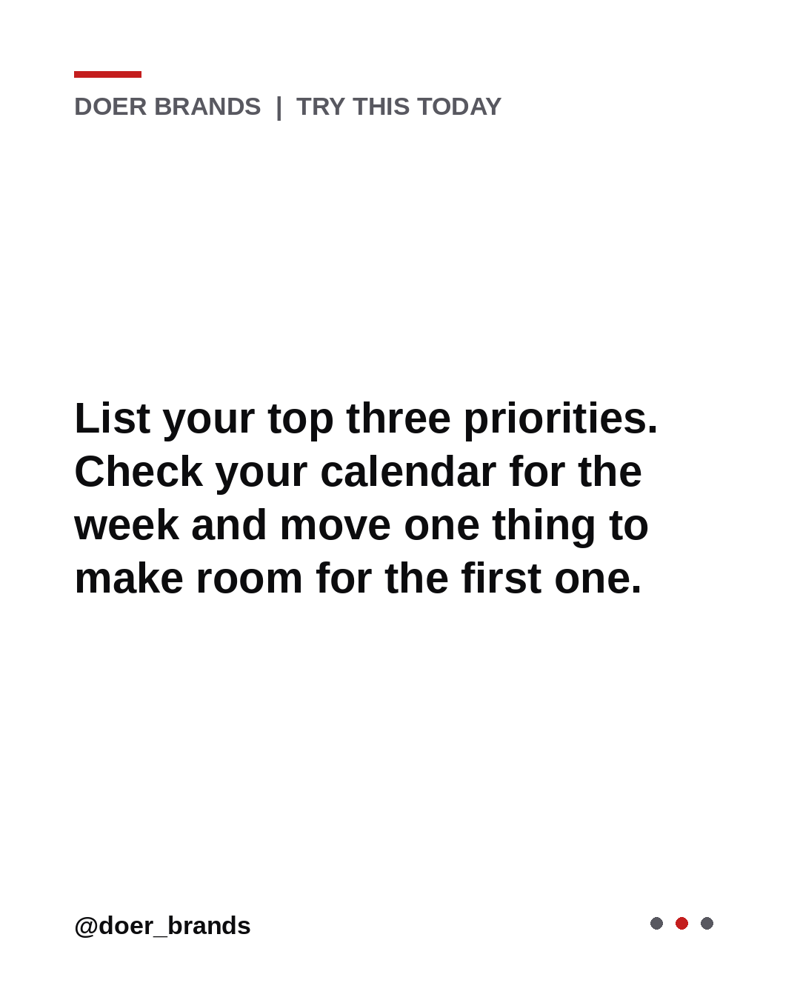
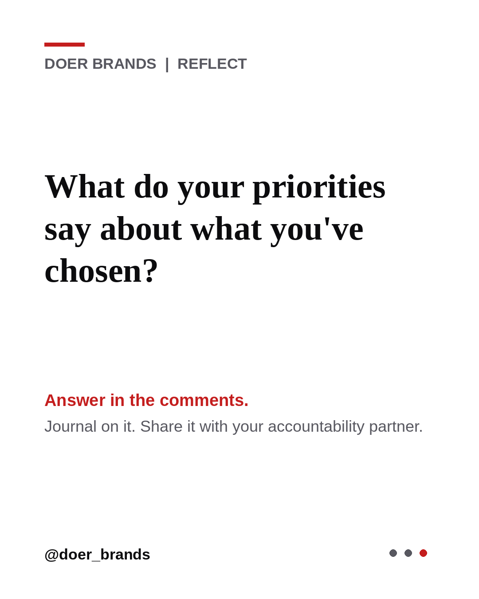
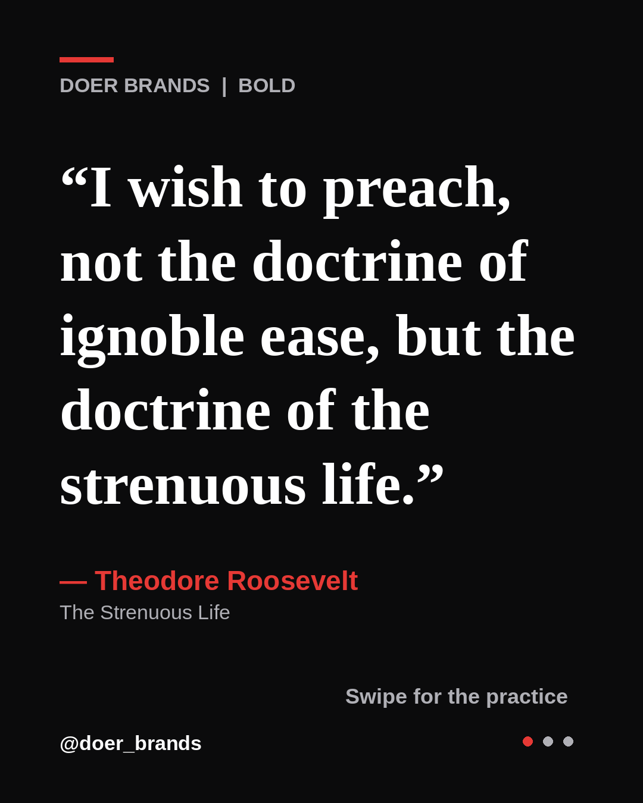
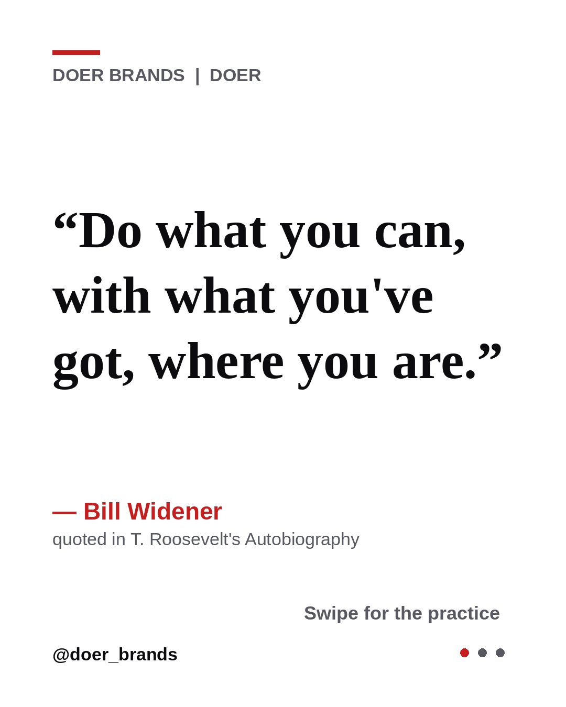

# Review queue

Pending = needs your approval. Approved = will post. Use the **Approve posts** action.

## PENDING | `20261117-a0f840` | Accountability

  

> High standards and real care can live together.
> 
> “Hold the standard high and the person higher.”
> 
> Try this today: When someone misses the mark, separate the two out loud: 'The result isn't where it needs to be, and I believe you can get it there.'
> 
> Who needs to hear that you believe in them? Tell me in the comments.
> 
> Save this for your next 1:1 and send it to a leader you respect.
> Follow @doer_brands for daily relational leadership.
> 
> #relationalleadership #leadership #leadershipdevelopment #listening #doerbrands #emotionalintelligence #managementtips

## PENDING | `20261120-05e43d` | Empowered

  

> You have more say in your next step than you think.
> 
> “To change your life, you need to change your priorities.”
> — John C. Maxwell, Today Matters
> 
> Try this today: List your top three priorities. Check your calendar for the week and move one thing to make room for the first one.
> 
> What do your priorities say about what you've chosen? Tell me in the comments.
> 
> Save this in your journal, or share it with a trusted advisor or accountability partner who will keep you moving.
> Follow @doer_brands. Be bold. Be empowered. Be a DOER.
> 
> #doerbrands #beadoer #maninthearena #consistency #discipline #endurance #empowered

## PENDING | `20261122-3eab06` | Bold

  

> Bold is a decision, not a feeling.
> 
> “I wish to preach, not the doctrine of ignoble ease, but the doctrine of the strenuous life.”
> — Theodore Roosevelt, The Strenuous Life
> 
> Try this today: Choose the harder option once today: take the stairs, make the call, do the extra set.
> 
> Where have you chosen ease over effort lately? Tell me in the comments.
> 
> Save this in your journal, or share it with a trusted advisor or accountability partner who will keep you moving.
> Follow @doer_brands. Be bold. Be empowered. Be a DOER.
> 
> #doerbrands #beadoer #maninthearena #consistency #entrepreneur #personalgrowth #bebold

## PENDING | `20261125-f57645` | Doer

  

> Doers start before they feel ready.
> 
> “Do what you can, with what you've got, where you are.”
> — Bill Widener, quoted in T. Roosevelt's Autobiography
> 
> Try this today: List what you have right now: time, tools, people. Pick one action you can take with it today, without waiting for more.
> 
> What can you do today with what you have? Tell me in the comments.
> 
> Save this in your journal, or share it with a trusted advisor or accountability partner who will keep you moving.
> Follow @doer_brands. Be bold. Be empowered. Be a DOER.
> 
> #doerbrands #beadoer #maninthearena #leadership #entrepreneur #empowered #discipline
