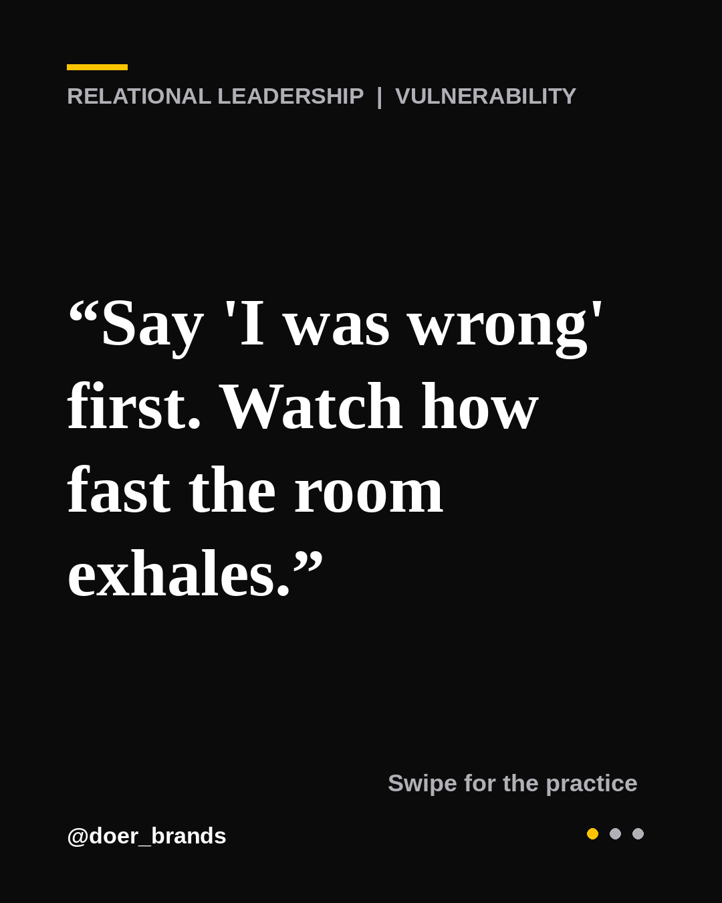
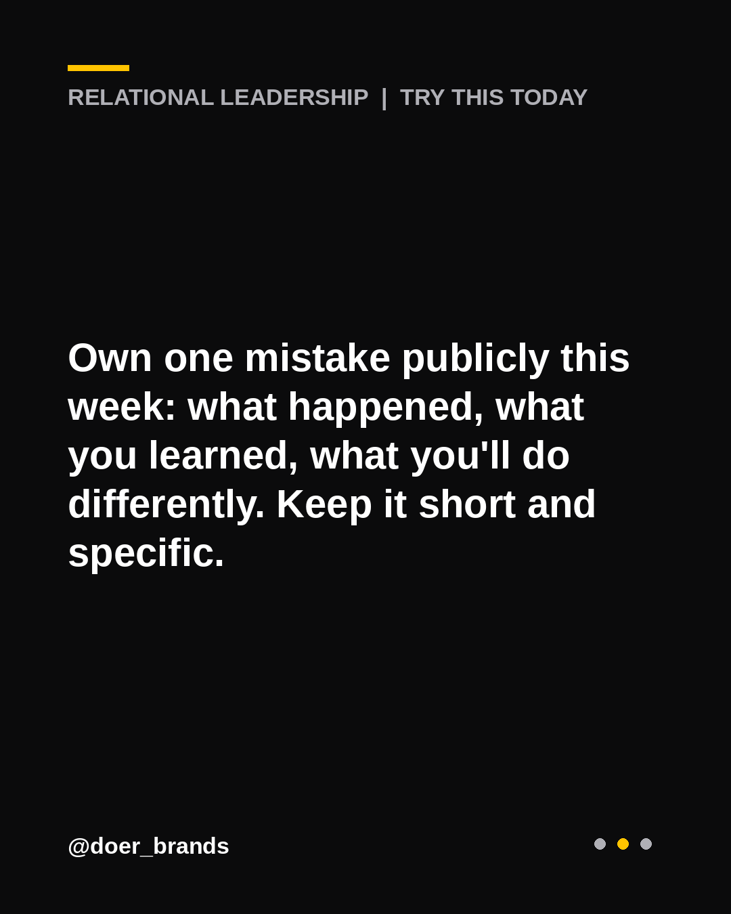
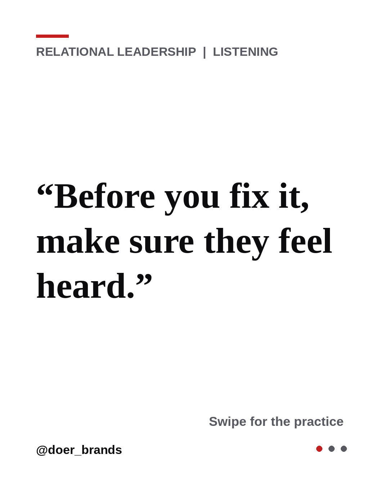
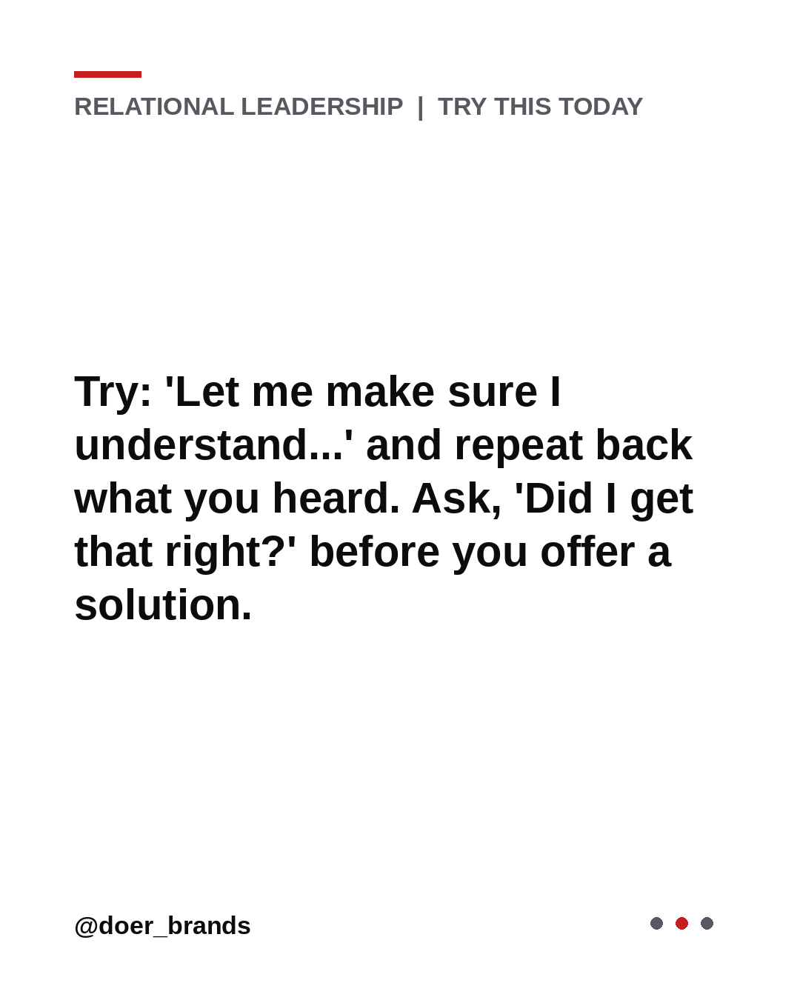
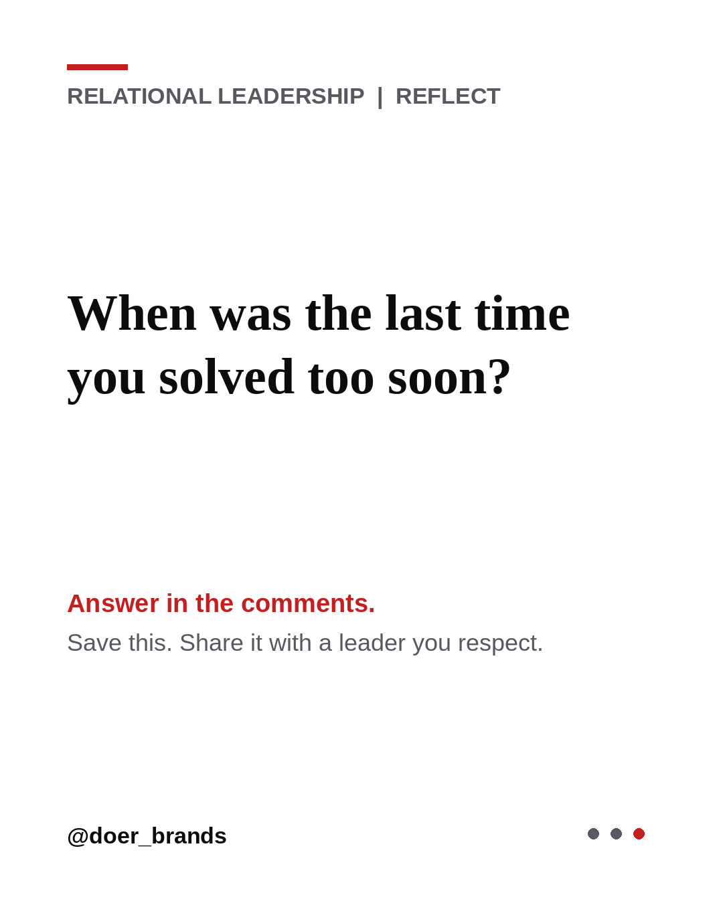

# Review queue

Pending = needs your approval. Approved = will post. Use the **Approve posts** action.

## PENDING | `20261016-50bff1` | Appreciation

  

> People do better work when they know it matters.
> 
> “'Great job' fades. 'Here's what you did and what it changed' stays.”
> 
> Try this today: Send one message today: name the specific action, the impact it had, and why it mattered to you.
> 
> Who deserves a specific thank-you today? Tell me in the comments.
> 
> Save this for your next 1:1 and send it to a leader you respect.
> Follow @doer_brands for daily relational leadership.
> 
> #relationalleadership #leadership #leadershipdevelopment #communication #managementtips #trust #teamculture

## PENDING | `20261016-9dd0d1` | Courageous Conversations

  

> Clarity is a form of kindness.
> 
> “Say the hard thing early, privately, and with their best interest at heart.”
> 
> Try this today: Choose a private moment within 48 hours of the issue. Start with your intent: 'I'm raising this because I want you to succeed.'
> 
> What's one hard thing worth saying this week? Tell me in the comments.
> 
> Save this for your next 1:1 and send it to a leader you respect.
> Follow @doer_brands for daily relational leadership.
> 
> #relationalleadership #leadership #leadershipdevelopment #trust #managementtips #listening #leadershipcoaching

## PENDING | `20261016-9e737b` | Vulnerability

  

> Going first makes it safe for everyone else.
> 
> “Say 'I was wrong' first. Watch how fast the room exhales.”
> 
> Try this today: Own one mistake publicly this week: what happened, what you learned, what you'll do differently. Keep it short and specific.
> 
> What mistake is worth owning out loud? Tell me in the comments.
> 
> Save this for your next 1:1 and send it to a leader you respect.
> Follow @doer_brands for daily relational leadership.
> 
> #relationalleadership #leadership #leadershipdevelopment #managementtips #emotionalintelligence #doerbrands #servantleadership

## PENDING | `20261016-a325bc` | Trust

  

> Trust is built in small moments.
> 
> “Be the leader whose words and calendar agree.”
> 
> Try this today: Look at your last week. Does your time reflect what you say matters? Move one meeting to protect one person or priority you named.
> 
> What does your calendar say you value? Tell me in the comments.
> 
> Save this for your next 1:1 and send it to a leader you respect.
> Follow @doer_brands for daily relational leadership.
> 
> #relationalleadership #leadership #leadershipdevelopment #leadershipcoaching #managementtips #doerbrands #trust

## PENDING | `20261016-a7565f` | Curiosity

  

> The best leaders stay curious about people.
> 
> “Curiosity is respect in action.”
> 
> Try this today: When you disagree today, ask 'Help me understand how you see it' before you share your view.
> 
> Where could curiosity replace your certainty today? Tell me in the comments.
> 
> Save this for your next 1:1 and send it to a leader you respect.
> Follow @doer_brands for daily relational leadership.
> 
> #relationalleadership #leadership #leadershipdevelopment #servantleadership #leadershipcoaching #trust #communication

## PENDING | `20261016-c2509e` | Presence

  

> Attention is the rarest gift a leader gives.
> 
> “Your team will forget what you said long before they forget how present you were.”
> 
> Try this today: Open your next meeting by asking one person a real question about them, and listen to the whole answer.
> 
> How present were you in your last conversation? Tell me in the comments.
> 
> Save this for your next 1:1 and send it to a leader you respect.
> Follow @doer_brands for daily relational leadership.
> 
> #relationalleadership #leadership #leadershipdevelopment #listening #communication #servantleadership #leadershipcoaching

## APPROVED | `20261016-5f6bfd` | Listening

  

> Most people don't need advice. They need to be heard.
> 
> “Before you fix it, make sure they feel heard.”
> 
> Try this today: Try: 'Let me make sure I understand...' and repeat back what you heard. Ask, 'Did I get that right?' before you offer a solution.
> 
> When was the last time you solved too soon? Tell me in the comments.
> 
> Save this for your next 1:1 and send it to a leader you respect.
> Follow @doer_brands for daily relational leadership.
> 
> #relationalleadership #leadership #leadershipdevelopment #communication #trust #listening #doerbrands
